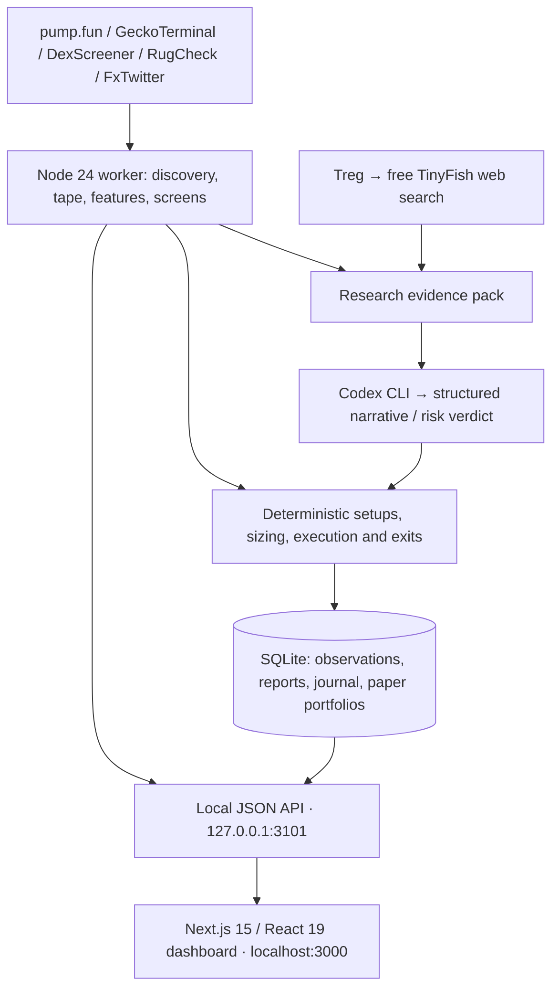

# Don't Get Nuked

A local Solana meme-coin research and **paper-trading** dashboard. It watches pump.fun launches, final-stretch coins and migrated pools, screens their flow and holders, researches their narrative, and compares a simulated strategy with two control portfolios. There is no wallet signing or real order execution.

## Implemented

- Dashboard: paper wallet, open/closed positions, equity curve, decisions, activity and pause/resume.
- Market: three discovery lanes, 14 deep-watch slots, live flow, insider cohorts, risk screens and setup readiness.
- Coin detail: price chart, trades, holder/social evidence, analyst verdict and simulated fills.
- Research: durable Codex reports, search queries and source provenance, plus each report's actual effect on paper decisions, orders and fills.
- Performance: strategy vs every-setup shadow book vs random baseline; per-setup and per-analyst outcomes; early-life feature dataset and CSV export.
- Current workspace also includes creator-history lookup, top-holder wallet age/shared-funder checks, and an evidence panel comparing features and screens with observed outcomes.
- Five setups: new-launch dump/recovery, deep final-stretch recovery, final-stretch pullback, creator-supported base, migrated base.
- Deterministic risk/execution: fees, slippage, fill delay/failure, sizing, stops, profit-taking, trailing/time exits, loss/drawdown limits and cooldowns.

## Architecture



`agent/main.ts` schedules independent, non-overlapping loops. `state.ts` owns the universe; `sources.ts` and `http.ts` fetch and rate-limit data. `features.ts`, `screens.ts`, `setups.ts`, `execution.ts` and `portfolio.ts` implement the trading pipeline. `research.ts` collects evidence; `analyst.ts` and `codex.ts` produce structured analysis. `regime.ts` gates entries; `dataset.ts` collects early-life samples. SQLite lives at `agent/data/agent.sqlite`.

Next.js `/api/agent/*` proxies to the local worker. The worker runs independently of an open browser, optionally supervised by macOS launchd. The browser never receives the Treg credential.

## Setup

Requires Node 24+, npm and a Codex CLI logged in with ChatGPT (`codex login`, then `codex login status`). The desktop app's bundled CLI is supported. A separate OpenAI API key is not required.

```bash
npm install
cp .env.example .env.local  # first setup only; preserve an existing file
chmod 600 .env.local
```

Set `TREG_TOKEN` privately in `.env.local`. Optionally set `CODEX_BIN` to the absolute executable path and `ANALYST_MODEL` to a model available to your login. Without `ANALYST_MODEL`, the isolated run uses the CLI default. The worker allows up to 20 analyst calls/hour (`ANALYST_MAX_PER_HOUR`); these consume your Codex usage allowance.

```bash
npm run research:check  # live Treg → Codex check; no portfolio writes
npm run agent          # terminal 1: worker
npm run dev            # terminal 2: http://localhost:3000
```

On macOS, use `npm run agent:install` once to supervise the worker at login. `agent:status`, `agent:start` (also restarts), `agent:stop` and `agent:uninstall` manage it. Logs are in `agent/logs/`; changing `.env.local` requires a worker restart.

## Treg and Codex

There are two connections:

1. **Interactive Codex research:** Treg CLI plus `https://treg.to/mcp/` in private `~/.codex/config.toml`. The desktop app and CLI share this config. Start a new chat after configuration; restart the app if the tools have not refreshed. The official Treg skill is in `~/.codex/skills/treg/SKILL.md`.
2. **App research:** the worker calls Treg over HTTP, builds evidence and invokes `codex exec` for a JSON-schema verdict. It uses an isolated directory, read-only sandbox, no inherited user plugins/MCP setup and no persistent Codex session. TREG_TOKEN and provider API keys are not passed to the analyst. The deterministic engine remains responsible for simulated trades.

Automatic search is **free-only**: TinyFish's catalog price must be explicitly $0; requests have a zero cost ceiling and disable provider waterfall. Reported charges disable further requests until restart. Health includes the last call ID, actual cost, successful-search time and result count. Failed searches are unavailable evidence, not proof of fraud. Manual Codex/Treg research for this repository follows the same policy in AGENTS.md.

Each coin gets up to five bounded searches: exact contract, name/ticker, linked social account/post, website/community, and narrative context from available social text (or a name-based origin query). The worker records query purpose, status, call ID, reported cost and result URLs. It deduplicates up to 24 retrieved sources and distinguishes exact-contract mentions from name/narrative context. Metadata URLs are leads, not retrieved sources; Codex may cite only supplied snippets or retrieved social text. All generated analysis and application UI are in English.

`/research` (or `/research?mint=CONTRACT`) reads the SQLite journal. Each new report has a stable ID, propagated through decisions, orders, fills and closed positions. Entry decisions compare the same market/account snapshot with and without analysis, using the existing 0.5× default in the latter. Labels distinguish blocked entries, changed sizing, minimum-size eligibility, unchanged decisions, other risk gates and expired/missing reports. Analyst exits also check whether the remaining liquidity rule would have exited anyway. These comparisons never place orders. Existing setup, risk, execution and exit rules are preserved; research alone cannot create an entry.

Order submission, failed/expired orders and simulated fills are separate events. Missing terminal events remain unconfirmed (including orders lost during a restart). Historic records without IDs are not retroactively attributed. The read-only audit shows the last seven days, capped at 60 recent reports and 300 decisions per view, plus any older reports referenced by those decisions; filter by coin to narrow it. A linked position's realized PnL is not a causal estimate of research profit.

For a read-only live check of the expanded search using an app-known coin, run `npm run research:check -- --mint CONTRACT`. It collects free research in an in-memory process and does not save a verdict or place paper orders. Without `--mint`, the command checks Treg and the Codex structured-output connection.

```bash
treg catalog get tinyfish.web.search
treg --json call tinyfish.web.search --query 'query=Solana official documentation' --query domain_type=web --header 'X-Treg-Route-Max-Cost: 0' --header 'X-Treg-Route-Waterfall: 0'
treg balance
```

Credentials stay in ignored `.env.local` and private user config (`~/.treg/config.json`, `~/.codex/config.toml`), with owner-only permissions. Do not print or commit them.

References: [Treg integration guide](https://treg.to/llms.txt), [Codex MCP configuration](https://learn.chatgpt.com/docs/extend/mcp?surface=cli).

## Development status and limits

This is a working local research prototype, not a validated profitable strategy. The data → screens → setups → paper execution → measurement loop exists. Reports appear on coin pages and in the activity feed.

Remaining gaps include source reliability (observed 429s/timeouts and incomplete launch tape), validation and coverage of the new wallet/creator checks, enough labeled data to train/validate a classifier, and long-run out-of-sample evaluation. Wallet checks are bounded to top holders and limited RPC history; creator queries are capped and fall back to local observations. An unavailable/expired analyst verdict currently permits reduced-size paper exploration; it does not halt all entries. Simulation does not establish actual on-chain execution quality.

The control API is designed for local use. Hosted multi-user operation would need authentication, deployment/service design and stronger monitoring. The design notes in `docs/` retain historical research and proposals; code and this README describe implemented behavior.

```bash
npm test
npm run lint
npx tsc --noEmit
npm run build
```
